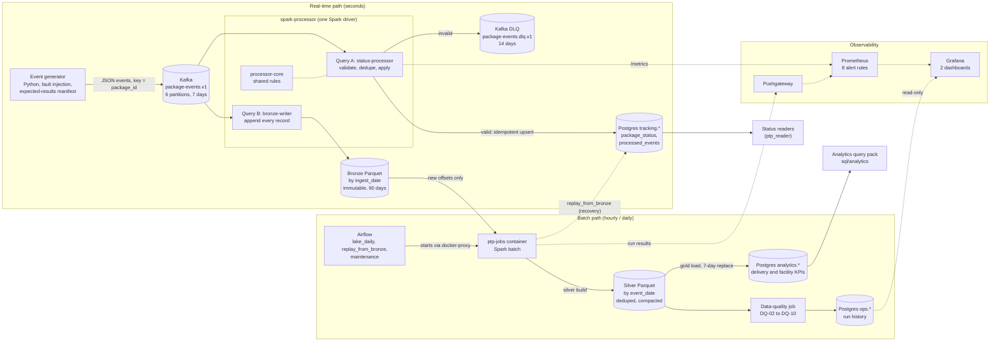

# Real-Time Package Tracking and Analytics Platform

A local, production-style data platform. Package scan events flow through Kafka into Spark
Structured Streaming, which keeps a trustworthy current status for every package in
PostgreSQL and lands the full history in partitioned Parquet. Hourly batch jobs turn that
history into delivery-delay and distribution-centre analytics. Prometheus and Grafana
watch every step. The pipeline tolerates duplicated, late, out-of-order and malformed
events, and recovers after outages.

Everything runs on one machine with Docker Compose. No cloud account or paid service is needed.

> **Status:** steps 1–8 are implemented and tested: generator, validation, streaming status, bronze and replay, silver and gold, data quality, Airflow, and observability. CI runs on every pull request; see [CONTRIBUTING.md](CONTRIBUTING.md).

**Stack:** Scala 2.13 · Spark 4.1.3 Structured Streaming · Kafka 4.3 (KRaft) · PostgreSQL 17 · Parquet · Airflow 3.3 · Python 3.12 · Prometheus · Grafana · Docker Compose · GitHub Actions. Exact pins are in [ADR-0001](docs/adr/0001-repo-and-stack-versions.md).

## Architecture



Solid arrows carry data; dotted arrows are recovery, metrics, or shared code.

### Components

| Component | What it does | Upstream (feeds it) | Downstream (it feeds) |
|---|---|---|---|
| **Event generator** (`generator/`) | Simulates scanners, vehicles and apps: realistic package lifecycles plus deliberate duplicates, late, out-of-order and malformed events. Writes a manifest of the expected outcome. | Scenario files in `bench/scenarios/` | Kafka; the manifest is the answer key for `make reconcile` and the tests |
| **Kafka** | Durable log, ordered per package (key = `package_id`). Kafka stamps the ingest time (LogAppendTime). Topic auto-creation is off. | Generator | Query A, Query B |
| **processor-core** (`processor/core`) | Pure Scala rules with no Spark: validation and error codes, the status preference order, content hash. | Event contract (`contracts/`) | Query A, replay, gold and DQ rules |
| **Query A: status-processor** | Validates every record, drops duplicates within a 2-hour watermark, sends invalid ones to the DLQ, and applies valid ones to Postgres in one transaction per partition. | Kafka | `tracking.*`, DLQ, `ops.sink_batches`, `/metrics` |
| **Query B: bronze-writer** | Appends every consumed record, valid or not, to Parquet with an `is_valid` flag. | Kafka | Bronze Parquet |
| **Postgres `tracking.*`** | Current status, one row per package (`package_status`), the dedup ledger (`processed_events`) and anomalies. | Query A, replay | Status readers, DQ job, Grafana |
| **Bronze Parquet** (`data/lake/bronze`) | Immutable raw history, partitioned by `ingest_date`. Source for every rebuild. | Query B | Silver build, replay |
| **Airflow** (`orchestration/airflow`) | Schedules and retries; no business logic. Starts the `ptp-jobs` image through a socket proxy that only allows container and image calls. | Schedules, manual triggers | `ptp-jobs` containers |
| **ptp-jobs** (`infra/jobs`) | The same jar as the stream, run as Spark batch jobs: silver, gold, dq, maintenance, replay. | Airflow or `make` targets | Silver, gold, `ops.*`, Pushgateway |
| **Silver Parquet** (`data/lake/silver`) | One row per unique valid event, partitioned by `event_date`, typed, with lineage. Built incrementally and compacted. | Bronze | Gold load, DQ job |
| **Postgres `analytics.*`** (gold) | Delivery facts, facility visits and daily KPI tables. | Silver | Query pack, Grafana |
| **Data-quality job** | Checks DQ-02 to DQ-10. A critical or high failure exits 1, which fails the Airflow run. | Silver, Postgres, DLQ | `ops.dq_results`, `tracking.status_anomalies` |
| **Prometheus, Pushgateway, Grafana** (`infra/observability`) | Scrape the driver, collect batch-job results, evaluate 8 tested alert rules, show 2 dashboards. | Driver `/metrics`, batch jobs, read-only Postgres | You |

The full design, with the status-apply algorithm and the alternatives considered, is in
[docs/specs/03-architecture.md](docs/specs/03-architecture.md).

## How one event flows, end to end

1. **Emit.** The generator publishes a JSON event such as `PICKED_UP` or `DELIVERED` to `package-events.v1`, keyed by package ID. All events for one package land in the same partition, in order.
2. **Read twice.** One Spark driver runs two streaming queries over the topic, each with its own checkpoint. Query A maintains status; Query B archives.
3. **Validate.** Query A checks each record against contract v1 using `processor-core`. A failure gets one of 14 error codes, for example `INVALID_TIMESTAMP`, and goes to the DLQ with the raw payload and source offset.
4. **Apply.** Valid events are deduplicated by `event_id`. Then, per Spark partition, one Postgres transaction:
   1. inserts the IDs into `tracking.processed_events`, where only new IDs count;
   2. upserts `tracking.package_status` with a preference guard: a terminal event beats a non-terminal one, and otherwise the later event wins.

   Retries and replays therefore can't double-count or move a status backwards. The status is queryable within seconds.
5. **Archive.** Query B appends every record to bronze Parquet, partitioned by `ingest_date`.
6. **Silver (hourly).** `lake_daily` reads only bronze offsets newer than its watermark and rebuilds just the affected `event_date` partitions in a staging directory, then swaps them in. It keeps the earliest copy of each event and compacts to one file per date.
7. **Gold (hourly).** Spark computes delivery facts and facility visits from silver, stages them in `ops.gold_stage_*`, then replaces the last 7 days of `analytics.*` in a single transaction.
8. **Data quality (hourly).** The DQ job writes `ops.dq_results`. A critical failure fails the run and fires an alert.
9. **Use.** Readers query current status. Analysts run `make query`. Operators watch Grafana and the Prometheus alerts.

## Data layers

| Layer | Where | Grain | Retention |
|---|---|---|---|
| Raw log | Kafka `package-events.v1` | One message per emitted event | 7 days |
| Rejected | Kafka `package-events.dlq.v1` | One record per invalid message, with error code and source offset | 14 days |
| Bronze | `data/lake/bronze/package_events` | Every consumed record, by `ingest_date` | 90 days |
| Silver | `data/lake/silver/package_events` | One row per unique valid event, by `event_date` | 400 days |
| Current status | `tracking.package_status` | One row per package | Indefinite |
| Dedup ledger | `tracking.processed_events` | One row per applied event ID, daily partitions | 30 days |
| Gold | `analytics.*` | Delivery facts, facility visits, daily KPIs | Indefinite |
| Run history | `ops.*` | `sink_batches`, `gold_runs`, `dq_results`, `replay_runs` | Indefinite |

## Guarantees per hop

No hop claims end-to-end exactly-once; each sink states its own guarantee
([ADR-0002](docs/adr/0002-delivery-semantics.md)), and each has a test.

| Hop | Guarantee | How |
|---|---|---|
| Generator → Kafka | At-least-once, no producer-session duplicates | Idempotent producer, `acks=all` |
| Kafka → Spark | At-least-once micro-batches | Offsets in the Spark checkpoint, committed after the sinks succeed |
| Spark → status | Effectively-once state | `processed_events` dedup plus the preference guard, one transaction per partition |
| Spark → DLQ | At-least-once | Consumers dedupe on source topic, partition and offset |
| Spark → bronze | Exactly-once for readers of `_spark_metadata` | File-sink commit log |
| Bronze → silver → gold | Idempotent rebuild | Deterministic dedup, partition swap, transactional window replace |

## Failure and recovery

| What breaks | What happens | How to recover |
|---|---|---|
| Processor restarts | Resumes from the last committed offsets; already-applied events are no-ops | Automatic, while the outage is shorter than Kafka's 7 days |
| Postgres is down | The micro-batch fails without committing offsets; alert `PtpSinkFailures` | Automatic retry once Postgres is back |
| Postgres data is lost | Status can be rebuilt from bronze with the same rules as the stream | `make replay FROM=yyyy-mm-dd` or the `replay_from_bronze` DAG |
| Bad data in the lake | DQ fails the `lake_daily` run; alert `PtpDqCriticalFailure` | Rebuild silver for the range: `make silver INGEST_FROM=… INGEST_TO=…` |

## Run it locally

Prerequisites: Docker Desktop with **at least 10 GB of memory**, JDK 17, sbt, Python 3.12, make.

```bash
make up            # Kafka + Postgres; creates .env with generated passwords, topics, roles, schema
make verify        # checks the stack (expect only PASS lines)
make image         # build the ptp-jobs image (Spark jobs jar)
make stream-up     # start the streaming processor (Query A + Query B)
make generate      # publish the smoke scenario; manifest in data/generator/smoke/
make reconcile     # compare Postgres with the manifest: the end-to-end correctness check
make status        # status distribution, DLQ and batch counts
make lake          # silver + gold + data-quality checks
make query Q=01_on_time_rate   # KPI queries in sql/analytics/ (01–05)
make obs-up        # Prometheus http://127.0.0.1:9090, Grafana http://127.0.0.1:3000
make airflow-up    # Airflow http://127.0.0.1:8080 (stop obs first if memory is tight)
make down          # stop everything, keep data
```

Passwords for Grafana (`GRAFANA_ADMIN_PASSWORD`) and Airflow (`AIRFLOW_ADMIN_PASSWORD`, user `admin`) are in `.env`.
`make help` lists every target.

| Compose profile | Containers | Start with |
|---|---|---|
| `core` | `kafka`, `kafka-init`, `postgres`, `pg-migrate` | `make up` |
| `stream` | `spark-processor` | `make stream-up` |
| `orchestration` | `airflow`, `docker-proxy` | `make airflow-up` |
| `obs` | `prometheus`, `pushgateway`, `grafana` | `make obs-up` |

### Tests

```bash
make test       # unit and contract tests, no Docker
make test-it    # integration tests with Testcontainers (Kafka, Postgres, Spark, generator)
```

## Repository layout

| Path | Contents |
|---|---|
| `docs/specs/` | Requirements, data contracts, architecture, acceptance tests |
| `docs/adr/` | Architecture decision records |
| `docs/spec-changes/` | Approved changes to the specs |
| `docs/traceability.md` | Requirement → implementation → test matrix |
| `docs/progress/` | Results of each implementation step |
| `contracts/` | JSON Schemas and sample payloads |
| `generator/` | Python event generator and the expected-results oracle |
| `processor/core` | Shared validation, status and DQ rules (Scala, no Spark) |
| `processor/streaming` | Spark streaming queries, replay, silver, gold, DQ jobs |
| `sql/` | Postgres migrations and the analytics query pack |
| `orchestration/airflow/` | DAGs and DAG checks |
| `infra/` | Docker Compose, Kafka, Postgres, jobs image, observability config |

## How this project is built

The project is spec-driven: requirements and acceptance criteria come first, every test is
tagged with the requirement it verifies, and specs change only through an approved proposal.

| Document | Purpose |
|---|---|
| [docs/specs/README.md](docs/specs/README.md) | Spec index, status, decisions |
| [docs/specs/01-functional-requirements.md](docs/specs/01-functional-requirements.md) | Requirements with stable IDs |
| [docs/specs/02-data-contracts.md](docs/specs/02-data-contracts.md) | Event, DLQ, Postgres and Parquet contracts |
| [docs/specs/03-architecture.md](docs/specs/03-architecture.md) | Components and data flow in detail |
| [docs/specs/07-acceptance-tests.md](docs/specs/07-acceptance-tests.md) | Acceptance criteria and test scenarios |
| [docs/adr/](docs/adr/) | Architecture decision records |
| [docs/traceability.md](docs/traceability.md) | Requirement → implementation → test matrix |
| [CONTRIBUTING.md](CONTRIBUTING.md) | Branches, pull requests and required checks |
